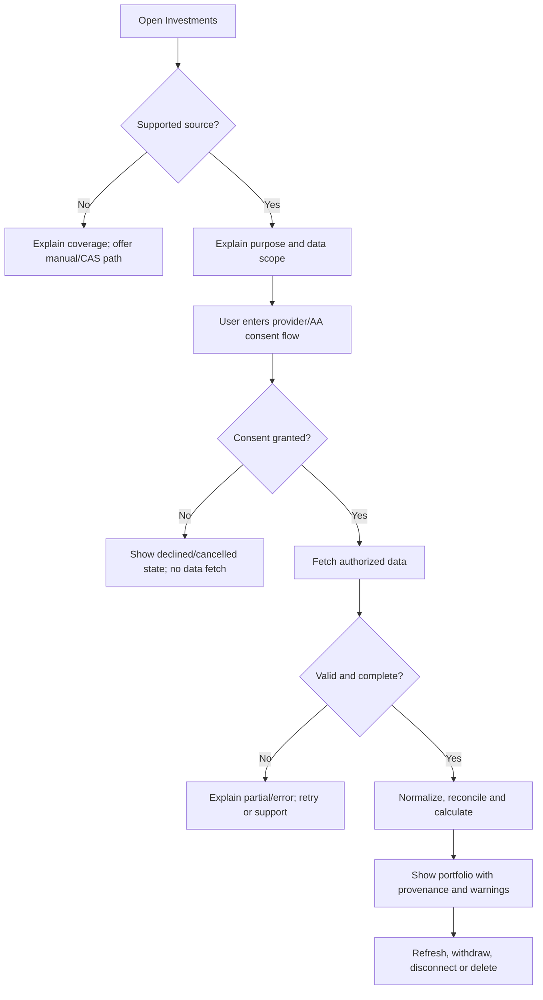

# User journeys

These journeys describe intended production behavior. The first diagram is a proposal, not a claim that these connections exist today.

## Journey A — connect a supported source

1. User opens investments and sees supported source coverage and alternatives.
2. User selects a source, reviews purpose/data scope/periodicity/recipient and opens the provider or AA consent flow.
3. User grants or declines consent at that provider.
4. Finanz receives a status, retrieves authorized data and validates the response.
5. User sees import progress and either a complete portfolio, a clearly marked partial result, or a recoverable error.
6. User reviews portfolio summary, source/freshness, holdings and warnings; can refresh, disconnect, withdraw consent or request deletion.



## Journey B — use consolidated statement or manual entry

The user chooses an available statement route, uploads/imports through an approved secure channel if one is designed, reviews detected holdings/transactions and corrections, then sees clearly marked source and estimated fields. Manual entry should remain possible for unsupported sources. The prototype’s bundled sample selection is only a demo; it does not upload or parse a user's statement.

## Journey C — understand a holding

From portfolio summary, the user opens holdings, filters by asset class, selects a holding, and reviews current value, units, NAV/price date, invested basis, return methodology, cash flows and source transaction rows. If opening units or cost basis are inferred, the UI explains the method and limits, and downstream figures inherit the estimate flag.

## Journey D — interpret performance and allocation

The user opens returns or allocation, selects a period/grouping, reads an explanation of the calculation and data date, and can inspect included assets and missing data. Benchmark comparison is shown only when benchmark source, time window and methodology are valid. No action CTA should turn an informational comparison into a buy/sell directive.

## Journey E — withdraw and delete

The user reviews active access, selects revoke/disconnect, confirms scope in a clearly stated reversible flow, and receives immediate status. New retrieval stops when revocation is effective; existing data follows the approved retention/deletion policy. The service records the request and completion evidence and provides support for exceptions.

```mermaid
sequenceDiagram
  actor User
  participant App as Finanz app
  participant AA as AA / source provider
  participant Store as Portfolio service
  User->>App: Select source and review consent details
  App->>AA: Initiate consent request
  AA-->>User: Present source consent interface
  User->>AA: Grant or decline consent
  AA-->>App: Consent status / reference
  alt granted
    App->>AA: Request authorized data
    AA-->>App: Data response or status
    App->>Store: Validate, normalize, retain provenance
    Store-->>App: Portfolio and quality flags
    App-->>User: Show read-only portfolio and freshness
  else declined or revoked
    App-->>User: Explain status; do not fetch / stop future fetches
  end
```

## Error and accessibility expectations

Every journey supports cancel/back, keyboard-only use, screen readers, zoom and small screens. Network loss must not imply success. Retry must be safe against duplicate records. A stale portfolio remains visibly stale. If no reliable calculation can be produced, show “unavailable” with the reason instead of a misleading zero.
