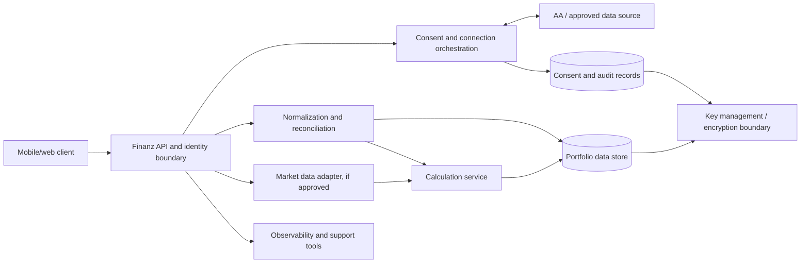

# Technical requirements

**Status:** discovery requirements; no production stack is selected.

## Current implementation

Repository inspection found README.md and a single self-contained 755 KB index.html. It is a client-side browser prototype with synthetic data and no server, persistent account store, provider SDK, live price feed, authentication, consent service, lender, broker or bureau integration. The live demo is GitHub Pages. Do not treat the deployed page or bundled JavaScript as production architecture.

## Proposed logical architecture

This is a logical decomposition to discuss. It does not prescribe cloud, language, database, vendor, AA role, hosting region, or who holds regulated responsibilities. Engineering and security should select the design after provider and legal diligence.

## Integration and API requirements

Use a provider adapter boundary so source-specific protocols do not leak into product logic. Define versioned internal schemas, idempotency keys, timeouts, retries with backoff, rate limits, circuit breaking, webhook/event authenticity, pagination, duplicate handling, schema evolution and source-specific error mapping. Validate signatures and payloads where applicable. Secrets belong in managed secret storage; never in frontend bundles. Separate sandbox and production credentials and data.

## Identity, consent and authorization

Threat-model the identity and linking process. Use least privilege and short-lived tokens where supported; bind data requests to a verified user, source and active consent. Enforce scopes server-side. Prevent IDOR and cross-account access. Record consent evidence and revocation status without retaining unnecessary sensitive artefacts. Define session timeout, step-up authentication and account recovery with security.

## Data lifecycle and protection

Classify PAN, contact identifiers, account identifiers, holdings, transaction histories, consent records and derived metrics. Minimize collection and retention; encrypt in transit and at rest; isolate tenants; restrict operator access; redact logs; define backup and deletion behavior; secure exports; test restore and incident response. Set retention periods only after legal, provider and operational review. Establish key rotation and breach notification playbooks.

## Reliability and observability

Monitor connection success, import latency, parsing/reconciliation errors, stale data, calculation failures, revocation/deletion completion and availability. Use correlation IDs that avoid sensitive values. Alert on abnormal provider errors and data drift. Define SLOs, support hours and recovery objectives before launch. Ensure users can distinguish a provider outage from their consent status.

## Quality attributes

Proposed: mobile-first performance on constrained networks; WCAG-aligned accessible interaction; localization readiness for Indian languages and currency/date formats; deterministic calculations with versioned methods; strong data provenance; auditability; graceful partial availability; and secure-by-default deployment. Quantitative thresholds require team agreement.

## Engineering deliverables before implementation

Architecture decision record (ADR), data classification and threat model, provider sandbox findings, API contracts, observability plan, migration/rollback design, calculation test vectors, accessibility plan, privacy data-flow map and runbooks. Production readiness requires security, legal/compliance, provider, product and engineering sign-off.
