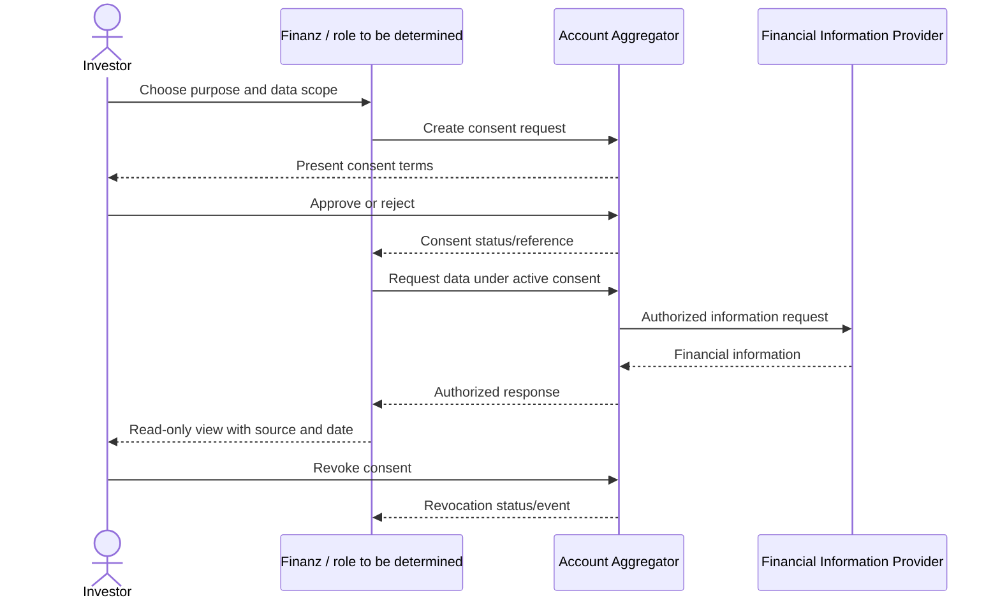

# Account Aggregator and provider integration evaluation

**Purpose:** capture known status, evaluation questions and a cautious integration model. It is not a provider approval, legal opinion, API specification or commercial commitment.

## Known project context

The task brief states that Finanz has already contacted Setu, Protean and CAMSFinServ. No meeting notes, emails, commercial terms, provider proposals, sandbox credentials, API specifications, onboarding outcomes, technical approvals or agreements were available in the inspected repository or project context. Status is therefore **contacted; details and next steps unverified**. The prototype itself explicitly says it connects to nothing.

The prototype names Zerodha, Groww, Angel One, ICICI Direct, Upstox, CAMS/KFintech and NSDL/CDSL as selectable demo choices. These are illustrative screens only. A selectable name is not evidence of provider participation or production access.

## Evaluation matrix

| Candidate / category | Known status in this handover | Verify with accountable owner |
|---|---|---|
| Setu | Contacted, per task brief; no evidence of agreement or approval reviewed | Exact legal entity/role, AA or technology scope, supported FIPs/data classes, sandbox, contracts, pricing, SLA, security, data location, consent/revocation behavior |
| Protean | Contacted, per task brief; no evidence reviewed | Product/role offered, source coverage, integration pattern, onboarding dependencies, commercial/security/legal terms, operational support |
| CAMSFinServ | Contacted, per task brief; no evidence reviewed | Exact service and data coverage, AA participation/role if relevant, supported formats, freshness, identity matching, fees, contract and operational limits |
| Other demo brands | Names appear in prototype only | Whether any outreach/relationship exists; capability, authorization, consent, technical and commercial due diligence |

Do not imply the providers are interchangeable. Evaluate based on the actual role they would perform and the relevant regulated entity, not brand recognition.

## AA flow to validate

The conceptual flow may include consent creation/presentation, user authentication with the relevant participant, consent status, data request, encrypted response, parsing/normalization, revocation and expiry. Actual actors, message formats, API semantics and responsibilities must be confirmed against the selected participant's current documentation and applicable framework requirements.

The diagram is illustrative only; confirm actual participant roles, sequence, transport, response format and event handling before design.

## Due-diligence checklist

1. **Regulatory and role:** Which entity acts as AA, FIU, FIP, technology provider or processor? Is Finanz eligible for the intended role/use? Who is accountable for consent and grievances?
2. **Coverage:** investment information types, identifiers, provider coverage, historical period, update cadence, joint/family accounts, rejected/closed accounts and partial responses.
3. **Consent:** purpose-specific scope, duration/frequency, data minimization, artefact, expiry, revocation latency, renewal, user-facing participant interface and audit evidence.
4. **Technology:** API/protocol versions, sandbox, payload schema, signing/encryption, callbacks, retries, idempotency, rate limits, availability, error taxonomy and change notice.
5. **Security/privacy:** certifications and audit reports, subprocessors, incident response, data residency, key management, retention/deletion, access controls and breach notification obligations.
6. **Commercial/operations:** setup and per-request pricing, minimums, SLA, support escalation, termination, exit/data portability and business continuity.
7. **Product/data quality:** source timestamps, corrections, corporate actions, duplicate identifiers, valuation dates and reconciliation path.
8. **Evidence:** retain dated notes and authoritative documentation in a controlled project location; record owner and verification date in [10-open-questions-and-decisions.md](10-open-questions-and-decisions.md).

## Decision gate

Do not select a provider or claim integration readiness until product, engineering, security, legal/compliance and commercial owners review documented evidence. If AA access or role is unsuitable, evaluate a user-supplied consolidated statement or manual entry as separate flows with their own secure handling and consent requirements.
