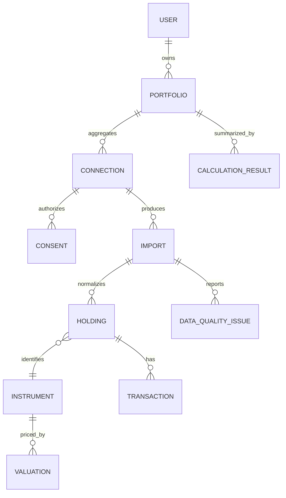

# Data model and calculation rules

**Status:** conceptual model and observed prototype examples. Production definitions, source coverage and validation remain open.

## Core entities (logical)

| Entity | Minimum candidate fields |
|---|---|
| User / Portfolio | internal pseudonymous ID, portfolio ID, locale, lifecycle status |
| Connection | provider/source ID, supported scope, status, linked portfolio, timestamps |
| Consent | purpose, data categories, frequency/duration, status, version/reference, granted/expiry/revoked timestamps |
| Import | source, request/status IDs, received/as-of times, parser version, completeness and errors |
| Instrument | canonical ID, name, type, issuer/fund house, currency, asset class, mapping confidence |
| Holding / Position | portfolio, instrument, account/folio, units/quantity, price/NAV, value, source date, provenance and estimate flags |
| Transaction / Cash flow | source transaction ID, date, type, units, unit price, gross amount, charges where available, currency, provenance |
| Valuation | instrument, value/price, effective date, source/licence, quality state |
| Calculation result | metric, period, value, method/version, input snapshot, timestamp, uncertainty |
| Data-quality issue | affected field/record, issue type, severity, user message, resolution state |
| Audit event | actor, action, time, correlation ID and minimal permitted context |

Store money in integer minor units or fixed decimal with explicit currency/precision; do not use binary floating point for financial arithmetic. Preserve source values and normalized values separately. Keep raw payload only when justified, protected, and retention-approved. Derived values must trace to input records and method version.

## Relationships

## Observed sample arithmetic

The prototype displays total value ₹9,02,383, amount invested ₹7,71,107, and gain ₹1,31,952. These reconcile as ₹9,02,383 − ₹7,71,107 = ₹1,31,276 unrealised plus ₹676 realised = ₹1,31,952 total gain. It also shows ₹7,75,431 in and ₹5,000 out; net cash invested is ₹7,70,431, which does not equal displayed amount invested ₹7,71,107. This suggests an opening-balance or other basis treatment requiring source-level verification; do not assume the UI's “invested” definition is simply net cash flows.

The sample statement summary says ₹8,12,450 while listed holdings total ₹9,02,383. The prototype warns about the mismatch and uses holdings. Production must expose which source wins and why, and should not silently substitute one figure.

## Candidate calculation definitions

- **Holding market value:** units × applicable NAV/price as of a stated timestamp, subject to corporate actions, rounding and source validity.
- **Portfolio value:** sum of included, non-duplicated position values for a common valuation cut; disclose stale/missing prices and exclusions.
- **Allocation share:** group market value ÷ portfolio value × 100. Prototype displays asset class, fund house and sector; sample shares are stated to total 100%.
- **Gain:** define cost basis and realised/unrealised treatment. Prototype sample total gain = current value − displayed amount invested; ensure redemptions, charges and opening balances are handled consistently.
- **Simple return / CAGR:** define start/end values and timing. Prototype says CAGR assumes every rupee was invested on day one.
- **XIRR:** annualized money-weighted return solving the dated cash-flow NPV equation; specify investor-perspective signs, terminal value, dates, missing/duplicate flows and solver tolerances. Return “not available” if no valid solution.
- **Measured swing:** prototype labels 6.4% as annualized daily ups and downs; exact estimator and series are unspecified and must be defined before production.
- **Benchmark:** instrument-specific benchmark mapping, same period, total-return/dividend treatment, source and licensing must be explicit.
- **Tax holding periods:** prototype gives explanatory threshold text but says it is not tax computation. Current rules, asset classifications and applicable tax treatment require legal/tax validation before any feature.

## Production controls

Version calculations, publish user-facing explanations, maintain reproducible test vectors, test rounding and edge cases, track missing and estimated inputs, and reconcile totals to source records. A field-level quality flag must flow into all dependent metrics. Never convert unknown or missing input to zero without an explicit rule.
